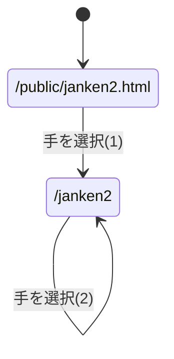

# 第7回 やってみよう

## (1) ラジオボタン版じゃんけん（/janken2）

元の `public/janken.html`，`views/janken.ejs`，`app5.js` の `/janken` は変更せず，以下を追加した．

| ファイル | 内容 |
|-|-|
| `public/janken2.html` | 最初の入力フォーム．グー/チョキ/パーをラジオボタンで選ぶ |
| `views/janken2.ejs` | 勝敗の表示と次の入力フォーム（ラジオボタン） |
| `app5.js` の `/janken2` | 手を受け取り，CPUの手を決めて勝敗を判定する |

勝敗判定は，手を グー=0，チョキ=1，パー=2 として
`(人間の手 - CPUの手 + 3) % 3` を計算し，0ならあいこ，2なら勝ち，1なら負けとした．
また，ラジオボタン以外から想定外の値が送られた場合は最初のページへリダイレクトする．

### ページ遷移図

#### (1)のパラメータ

パラメータ名 | 属性 | 内容 | 値
-|-|-|-
hand | radio | ユーザの手 | グー/チョキ/パー
win | hidden | 勝利数 | 0
total | hidden | 対戦数 | 0

#### (2)のパラメータ

パラメータ名 | 属性 | 内容 | 値
-|-|-|-
hand | radio | ユーザの手 | グー/チョキ/パー
win | hidden | 勝利数 | これまでの勝利数
total | hidden | 対戦数 | これまでの対戦数

## (2) リポジトリへの反映

`git add` → `git commit` → `git push` で各自のリポジトリに反映し，
`node app5.js` で起動して `http://localhost:8080/public/janken2.html` から動作を確認した．

## (3) input要素の type，name，id の働き

- **type**：入力欄の種類を指定する．`text`（文字），`number`（数値），`date`（日付），`radio`（ラジオボタン），`checkbox`，`hidden`（画面に表示しない値），`submit`（送信ボタン）などがあり，ブラウザが表示する部品や入力できる値が変わる．
- **name**：フォーム送信時のパラメータ名になる．`name="hand"` の入力欄に「グー」を入れて送信すると `/janken?hand=グー` のようなクエリパラメータになり，サーバ側では `req.query.hand` で値を取り出せる．name が無い入力欄の値は送信されない．また，ラジオボタンは同じ name を付けたものが1つのグループになり，その中から1つだけ選べる．
- **id**：HTML文書の中でその要素を一意に識別するための名前である．サーバには送られない．`<label for="id名">` と対応させることで，ラベルの文字をクリックしても入力欄やラジオボタンを選択できるようになる．CSSやJavaScriptから要素を指定するときにも使う．

## (4) htmlファイルとejsファイルの使い分け

- **htmlファイル**（`public/` に置く）は，誰がいつアクセスしても内容が同じ**静的なページ**に使う．サーバは `express.static` でファイルをそのまま送るだけである．例：`janken.html` の最初の入力フォームのように，まだ何の結果もないページ．
- **ejsファイル**（`views/` に置く）は，アクセスのたびに内容が変わる**動的なページ**のテンプレートに使う．`<%= 変数 %>` の部分をサーバのプログラムが `res.render('テンプレート名', {変数})` で値に置き換えてからHTMLとして送る．例：じゃんけんの結果（CPUの手，判定，勝利数など）を表示するページ．

つまり，サーバ側で計算した結果やフォームから受け取った値を埋め込む必要があるページはejs，そうでない固定のページはhtmlで作るのが一般的である．
