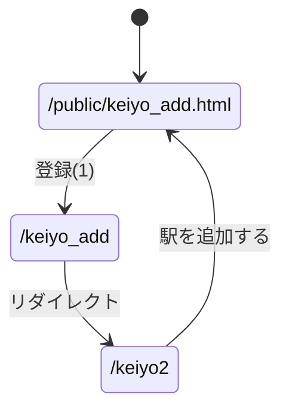
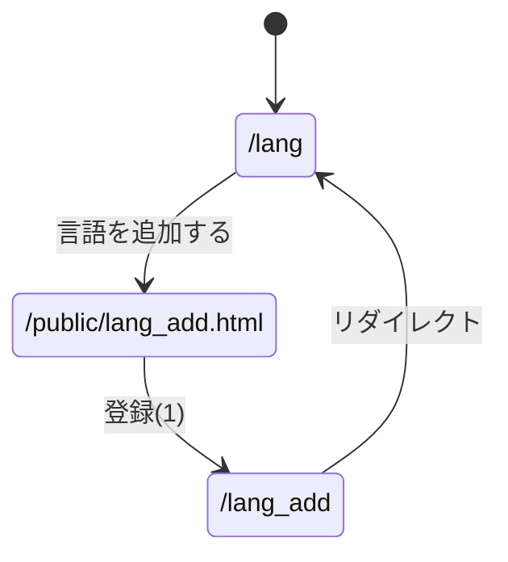

# 第8回 やってみよう

起動方法：`node app5.js` を実行し，`http://localhost:8080/` 以下にアクセスする．

## (1) 京葉線の駅の一覧表示とデータ追加

| URL | 内容 |
|-|-|
| `/keiyo` | 駅データを列挙して表示（`views/db1.ejs`） |
| `/keiyo2` | 駅データを表で表示（`views/db2.ejs`） |
| `/public/keiyo_add.html` | 駅を登録するフォーム |
| `/keiyo_add` | 受け取ったデータを `station` に追加する |

### データ登録後に表示するページの比較

- **データ入力画面（`res.redirect('/public/keiyo_add.html')`）**
  続けて何件も登録するには便利だが，登録できたかどうかが画面上で分からない．
- **データ一覧画面（`res.render('db2', ...)`）**
  追加したデータがすぐ確認できて分かりやすい．しかし，実際に試すと
  アドレスバーが `/keiyo_add?id=7&code=JE99&name=幕張メッセ` のまま残るため，
  ページを再読み込みすると同じデータがもう一度追加され，二重登録になってしまった．

そこで，追加後は一覧ページ `/keiyo2` に**リダイレクト**することにした．
これなら一覧で結果を確認でき，再読み込みしても `/keiyo2` を読み直すだけなので二重登録が起きない．
よって，データ一覧画面を表示するのが良いが，`res.render` で直接表示するのではなく
一覧ページへリダイレクトするのが最も良いと考える．

#### (1)のパラメータ

パラメータ名 | 属性 | 内容 | 値
-|-|-|-
id | number | ID | 数値
code | text | 駅コード | JE01など
name | text | 駅名 | 文字列

## (2) プログラミング言語の一覧表示

`/lang` で，プログラミング言語の ID，言語名，登場年，設計者 を表で表示する（`views/lang.ejs`）．
データは `app5.js` の配列 `lang` に入れている．

## (3) プログラミング言語の追加

`/public/lang_add.html` のフォームから言語名，登場年，設計者を入力すると，
`/lang_add` で配列 `lang` に追加し，一覧 `/lang` にリダイレクトする．
IDは入力させず，今ある最大のIDに1を足して自動で振るようにした（IDの重複を防ぐため）．

#### (1)のパラメータ

パラメータ名 | 属性 | 内容 | 値
-|-|-|-
name | text | 言語名 | 文字列
year | number | 登場年 | 1940〜2100
creator | text | 設計者 | 文字列

## 補足

データはサーバの変数に入れているだけなので，サーバを再起動すると追加したデータは消える．
本格的なサービスではDBサーバにデータを置く必要がある．
